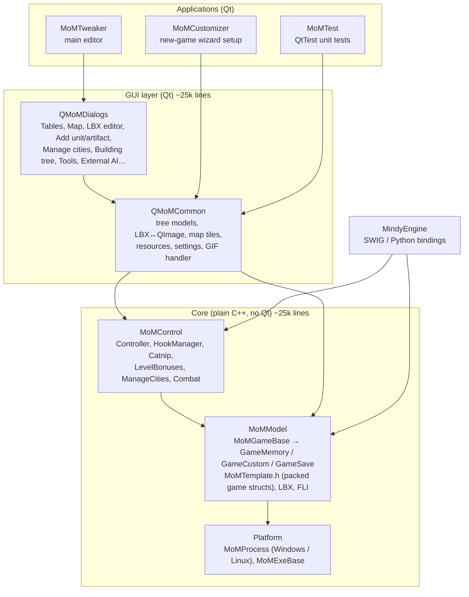
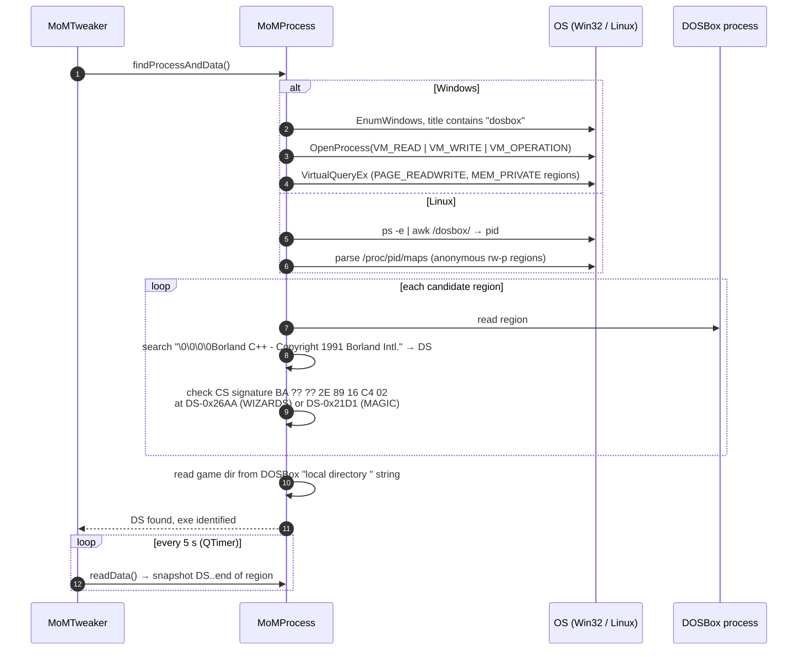
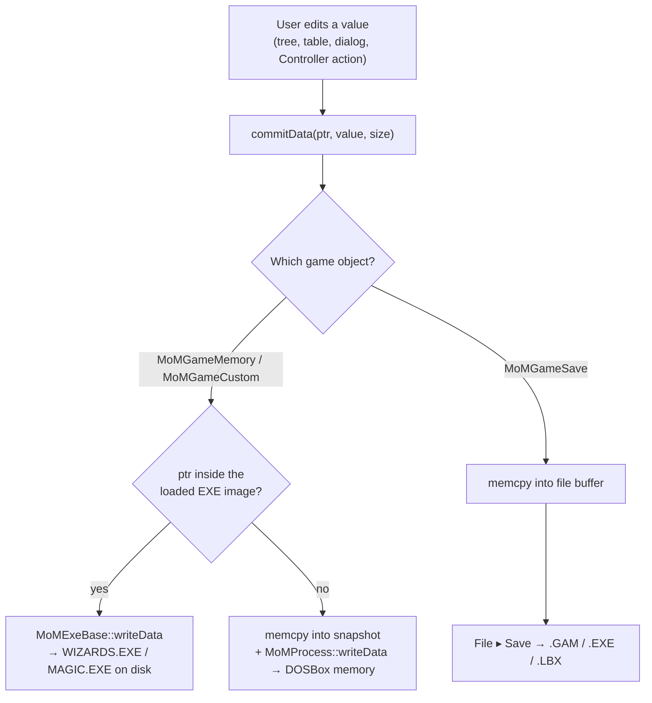
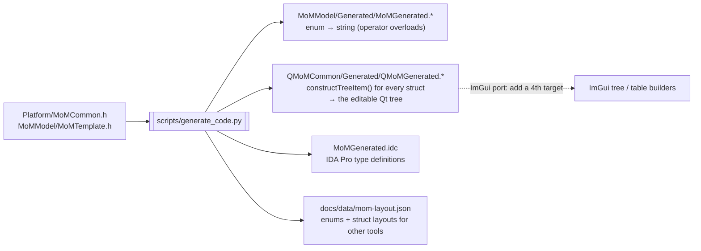
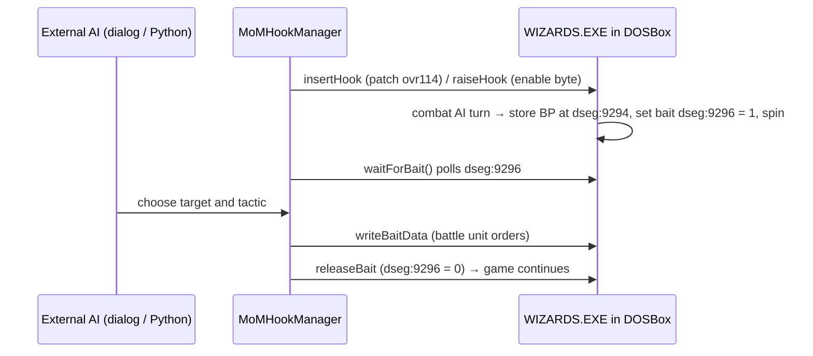

# How MoM-RTGT works

[← Home](index.md)

This page describes the code as it stands at version 0.3.4 (March 2020). Paths are
relative to the repository root.

## 1. Layers

The core is **already free of Qt**: no Qt types or includes in `Platform/`, `MoMModel/`,
`MoMControl/` or `Utility/`. Only the GUI layers and the applications use Qt.

## 2. Data sources

| Source | Class | Read | Write | Notes |
|---|---|---|---|---|
| Running `WIZARDS.EXE` (in-game) | `MoMGameMemory` + `MoMProcess` | yes | yes | memory of the DOSBox process |
| Running `MAGIC.EXE` (setup screens) | `MoMGameCustom` + `MoMProcess` | yes | yes | used by MoMCustomizer |
| `WIZARDS.EXE` / `MAGIC.EXE` on disk | `MoMExeBase`, `MoMExeWizards`, `MoMExeMagic` | yes | **patched in place, no backup** | data segment plus Borland overlay segments |
| `SAVEn.GAM` | `MoMGameSave` | yes | on *Save* | also recognises Caster of Magic saves by file size |
| `BUILDDAT/ITEMDATA/ITEMPOW/SPELLDAT/TERRSTAT.LBX` | `MoMGameSave` | yes | on *Save* | rule tables loaded as raw records |
| Any `*.LBX` | `MoMLbxBase`, `QMoMLbx`, `DialogLbxEditor` | yes | replace record + save | images, palettes, fonts, MIDI/VOC records |
| `*.FLI` | `MoMFli` | yes | no | import source for the LBX editor only |

### 2.1 Attaching to the live game

Platform calls: Windows uses `ReadProcessMemory` / `WriteProcessMemory`. Linux reads with
`PTRACE_ATTACH` + `pread64` on `/proc/pid/mem` and writes word by word with
`PTRACE_POKEDATA`. **macOS has no implementation.**

### 2.2 How an edit reaches the game

Every typed setter and every tree or table cell edit ends in
`MoMGameBase::commitData(ptr, newValue, size)`. The subclass decides where the bytes go:

Far and heap pointers stored in the data segment (spells, items, units, cities, battle
units, terrain) are resolved in `MoMGameMemory::readData`, so the model can show tables
that live outside DS.

## 3. One source of truth for the game structures

`MoMModel/MoMTemplate.h` (about 6,200 lines) declares the packed structs and enums that
mirror the game's memory: `SaveGame`, `MoMDataSegment`, `MoMMagicDataSegment`,
`Unit_Type_Data`, `Spell_Data`, `City`, `Wizard` and about 90 more.
`scripts/generate_code.py` (a Python translation of the original `generate_code.pl`) parses it and generates the rest:

`xml/momrtgt.xml` (with its `.xsd` schemas) describes some locations, such as the
level-bonus table at `ovr116:1EBA`, but **no code reads it**. It was a prototype of a
data-driven layout.

## 4. Code injection (MoMControl)

| Feature | What it changes | Source |
|---|---|---|
| **Hook / External AI** | Patches `Unit_strategy_exe` (ovr114, WIZARDS.EXE file offset `0x889E4`) so combat AI spins on a flag at `dseg:9296` while an outside program (dialog or Python) writes the unit's orders | `MoMHookManager.cpp`, `asm/Unit_strategy_exe_hooked.asm` |
| **Catnip mod** | Rewrites `set_hero_slot_types` (ovl130), writes new unit names into spare DS space at `0xEA60`, rewrites all `Unit_Type_Data` | `MoMCatnip.cpp`, `asm/set_hero_slot_types.asm` |
| **Level bonuses** | Injects new experience-level code and tables into ovl116 | `MoMLevelBonuses.cpp`, `asm/Experience_bonus.asm` |
| **Controller** | Add unit or artifact, buy production, polymorph to hero, replace race, repopulate lairs, tax and power | `MoMController.cpp` |
| **Combat calculator** | Read-only: expected damage and Monte Carlo battle outcomes | `MoMCombat.cpp` |

## 5. What content can be changed today

| Content | Status |
|---|---|
| Game rules and numbers: unit and hero types, spells, buildings, races, tax and unrest, level bonuses, game options | ✅ live, in the EXE, or in rule LBXs |
| Game state: wizards, cities, units, items, lairs, nodes, terrain, battle | ✅ live or in saves |
| Text strings | ⚠️ fixed-size char arrays and DS name strings only, so no longer strings or reflowed text |
| Pictures (LBX image records) | ⚠️ replace with a same-size PNG or FLI frame; palettes and fonts are view/export only |
| Executable code | ✅ the built-in mods above |
| **Sound effects (VOC)** | ❌ records are only classified (`DEAF 0002`) |
| **Music (XMIDI)** | ❌ records are only classified (`DEAF 0001`) |
| Animations (FLI) | ⚠️ import only |

## 6. Applications

- **MoMTweaker**: the main editor. Connects live (tries `MoMGameMemory`, then
  `MoMGameCustom`) or opens files through `MoMGameSave`. A tree view of the whole game,
  plus the dialogs.
- **MoMCustomizer**: a front end for creating a wizard on the `MAGIC.EXE` setup screens.
- **MoMTest**: QtTest unit tests (combat calculator, `REFTEST.GAM` round trip, main window).
- **MindyEngine**: SWIG Python bindings; `example_momai.py` takes over combat AI through
  the hook.
