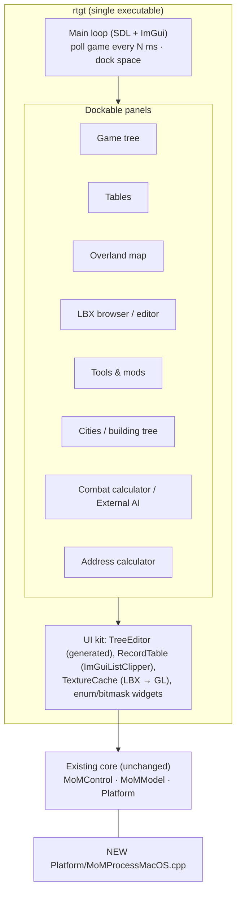
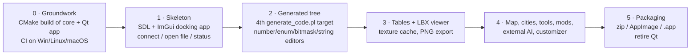

# Migrating MoM-RTGT from Qt to Dear ImGui

[← Home](index.md)

**Goal:** one portable executable per platform (Windows, Linux, macOS) that community
members can unzip and run, with no installer, no Qt DLLs and no `LD_LIBRARY_PATH`.

## 1. Why this is feasible

- The core (`Platform/`, `MoMModel/`, `MoMControl/`, `Utility/`, about 25k lines) has
  **no Qt dependency**. It stays as it is.
- Most of the GUI is generic: an editable tree generated from `MoMTemplate.h`, tables of
  game records, and image views. ImGui handles this kind of tool UI well.
- The code generator (`scripts/generate_code.pl`) already emits the Qt tree builders. A
  new back end can emit ImGui builders from the same structs.

## 2. Proposed stack

| Concern | Choice | Reason |
|---|---|---|
| UI | **Dear ImGui, `docking` branch** | The app is a dozen tool windows (tree, tables, map, LBX editor, tools). Docking lets users arrange them and saves the layout in `imgui.ini`. The docking branch is stable and widely used. |
| Window, input, GL | **SDL2 now, SDL3 later** (+ OpenGL 3 renderer) | Same as ReMoM, so the projects share build knowledge, CI and packaging. GLFW also works but would be a different stack. |
| Build | **CMake + presets** | Replaces the stale qmake/Makefile set. ReMoM's `CMakePresets.json` and CPack setup can be copied. |
| Images | Own LBX decoder → RGBA → GL texture; `stb_image` / `stb_image_write` for PNG import/export | Removes QImage/QPixmap/QIcon and the giflib/`QImageIOHandler` glue. |
| Bundled art (368 GIFs, 2 TTFs) | Compile into the binary (CMake `xxd`-style embed, or C++23 `#embed` when available) | Keeps it a single file, like `.qrc` does today. |
| Fonts | ImGui default plus the bundled TTFs through `ImFontAtlas` | Replaces the per-platform QFont choice. |
| File dialogs | `nativefiledialog-extended` (or ImGui's own file browser) | 36 `QFileDialog` uses. |
| Settings | `imgui.ini` for layout plus a small key/value file for paths | Replaces `QSettings`. Keep it next to the exe (portable mode). |
| Tests | doctest or Catch2 | The combat and game-base tests only touch the core, so they move easily. |

## 3. Target architecture

The Qt signal/slot broadcast (`signal_gameChanged` / `signal_gameUpdated`) becomes simpler.
Each frame the panels read the current `MoMGameBase`, and a "game changed" counter tells
caches when to rebuild.

## 4. Phased plan

1. **Groundwork** (done). A CMake build for the core with the Qt apps as an option, CI
   for all three operating systems, the core tests moved from QtTest to doctest, and
   a `MoMProcessMacOS.cpp` stub. Next: translate `scripts/generate_code.pl` to Python,
   with output identical to the committed generated files.
2. **Skeleton.** An ImGui app that can attach to DOSBox or open a `.GAM`/`.EXE`/`.LBX`
   and show connection status.
3. **Generated tree.** Extend the (Python) code generator to emit `drawTree(T*)` functions for
   every struct, using editors for numbers, enums (combo), bitmasks (checkboxes) and
   fixed strings. This is most of the tweaker's value.
4. **Tables and LBX viewer.** Port `DialogTables` using `ImGuiListClipper`, add the
   LBX→RGBA decoder and texture cache, and add PNG export and same-size replacement.
5. **The rest.** Map (ImDrawList with a tile atlas, zoom, pan, hover and context menus),
   manage cities, building tree, tools and mods, external AI, address calculator, and
   the Customizer as a panel.
6. **Packaging.** Ship a zip for Windows, an AppImage and a tarball for Linux, and a zip
   with an ad-hoc-signed `.app` for macOS. Then delete the Qt layers.

## 5. Portability notes per platform

| Platform | Live memory editing | Packaging |
|---|---|---|
| Windows | Works today (`ReadProcessMemory`). No admin needed for a same-user DOSBox. | Static CRT + SDL static, single `.exe` |
| Linux | Works today (`ptrace`). Many distros set `kernel.yama.ptrace_scope=1`, which blocks attaching to a non-child process unless run with `sudo` or given `CAP_SYS_PTRACE`. This needs documenting or a workaround (`process_vm_writev` has the same check). | AppImage or a static-ish tarball |
| macOS | **New code needed**: `task_for_pid` + `mach_vm_read_overwrite` / `mach_vm_write`. Needs root, or a binary signed with the `com.apple.security.cs.debugger` entitlement, and the target DOSBox must not use the hardened runtime (DOSBox Staging and DOSBox-X app bundles may need re-signing). | `.app` in a zip. Unsigned apps need "Open anyway" once in Gatekeeper. |
| Android | ❌ Not possible: apps cannot read another app's memory without root. | — |
| iOS | ❌ Not possible: same sandbox limits, and no DOSBox on the App Store that exposes files easily. | — |

**Mobile, realistically:** a *file-only* editor for saves, rule LBXs and EXE tables could
run on Android or iPad with SDL + ImGui, working on the game folder of an Android DOSBox
app (Magic DOSBox, DosBox Turbo) through the Storage Access Framework. ImGui is
mouse-first, so it would need larger touch targets and a one-panel-at-a-time layout
instead of docking. This is a "later, maybe" item that the architecture does not block.

## 6. What we still need to learn or decide

**Product and scope**
1. Which DOSBox builds must be supported: vanilla 0.74-3, DOSBox Staging, DOSBox-X, the
   GOG/Steam bundles? The DS search assumes DOSBox keeps emulated RAM in one anonymous
   private region. Check this on each build and on 64-bit versions.
2. Which game versions: v1.31 (GOG), v1.40n/insecticide, Caster of Magic? The spell
   save-offset table already varies between 1.31 and 1.40j, and the hook offset
   `0x889E4` is version-specific. We need a version-detection table.
3. Is MoMCustomizer kept as a separate app or folded into a "New game" panel?
4. Is MindyEngine (Python and SWIG) still wanted? It affects whether the core stays a
   reusable library.
5. Should EXE edits keep writing in place? Today there is **no backup**. Proposal:
   always write `WIZARDS.EXE.bak` first, or work on a copy.

**Technical unknowns**
1. macOS: does `task_for_pid` work against current DOSBox Staging builds (Apple Silicon,
   Rosetta)? Prototype this before promising Mac support for live editing.
2. Linux `ptrace_scope`: decide between documenting `sudo` / `setcap cap_sys_ptrace` and
   another route.
3. The DOSBox Staging and DOSBox-X memory layouts. Their emulated RAM may be allocated
   differently (mmap, page-locked), which affects region filtering.
4. Rendering the LBX formats that the tweaker does not render yet (animations, remapped
   colours), and whether to add VOC/XMIDI playback and replacement. ReMoM already has
   VOC and XMI format docs and SDL_mixer playback code.
5. Text editing beyond fixed buffers: relocating strings in DS needs free-space
   management (Catnip already uses `0xEA60`), which is risky.
6. Licensing: RTGT is GPL. Dear ImGui (MIT), SDL (zlib), stb (public domain / MIT) and
   NFD-extended (zlib) are all compatible. Running ReMoM's dependency-vetting checklist
   keeps the projects consistent.
7. The ImGui widget style for large trees: lazy expansion and clipping, so that thousands
   of nodes stay at 60 fps.

**Process**
- Who are the testers on each OS? The community (Realms Beyond, the MoM subreddit,
  Caster of Magic forums) could test early builds.
- Do we keep upstream compatibility with Klaas van Aarsen's original repo, or treat
  this as a continuing fork?
