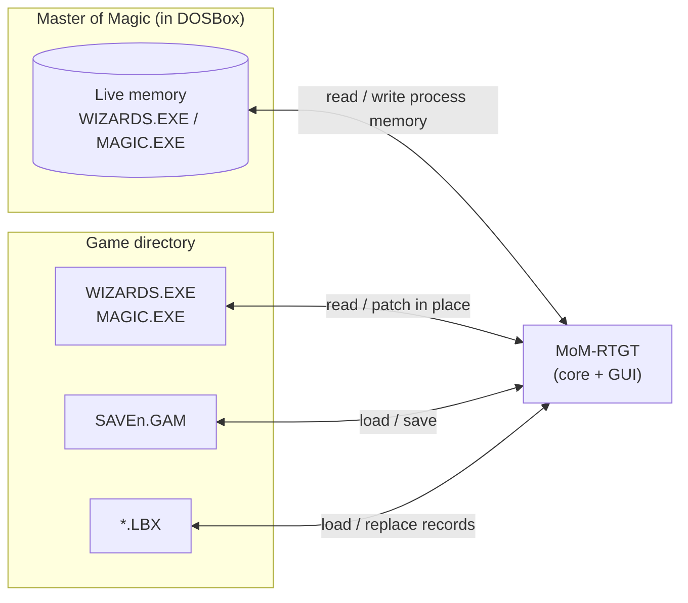

# MoM-RTGT — Master of Magic Real-Time Game Tweaker

MoM-RTGT edits *Master of Magic* (Simtex / MicroProse, 1994) while it runs in DOSBox,
and also edits its files on disk: `WIZARDS.EXE`, `MAGIC.EXE`, saved games (`SAVEn.GAM`)
and the `*.LBX` resource archives.

Originally written by Klaas van Aarsen ("I like Serena"), 2011–2020, GPL.

## Pages

- [How it works](architecture.md): data sources, the in-memory model, how edits reach
  the game, and what kinds of content can and cannot be changed today.
- [ImGui migration plan](imgui-migration.md): moving the GUI from Qt to Dear ImGui as a
  portable, no-install app for Windows, Linux and macOS, plus what we still need to learn.
- [Shared knowledge with Simtex Universe / ReMoM](shared-knowledge.md): which
  offsets, structures and file formats overlap, and a proposal for one shared,
  machine-readable source.

## At a glance

