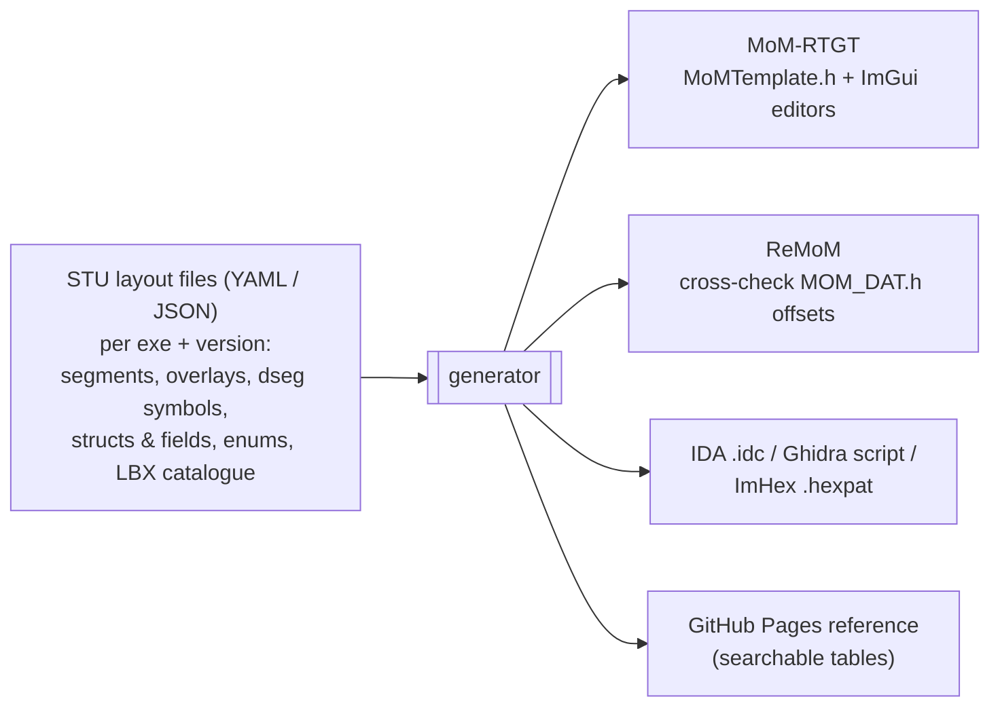

# Shared knowledge: MoM-RTGT, ReMoM and Simtex Universe

[← Home](index.md)

Three projects describe the same bytes:

| Project | What it knows | Form |
|---|---|---|
| **MoM-RTGT** | Packed C structs for the data segment, save game, unit/spell/building tables; overlay offsets of patch sites; LBX record types | `MoMModel/MoMTemplate.h`, `Platform/MoMCommon.h`, generated `MoMGenerated.idc`, `xml/momrtgt.xml` (unused) |
| **ReMoM** | A complete C reconstruction of WIZARDS.EXE and MAGIC.EXE v1.31 with `dseg` and segment/overlay annotations; LBX, VOC and XMI format docs | `MoX/src/MOM_DAT.h/.c`, `doc/WZD-Segments.md`, `doc/___LBX/*.md`, `doc/Audio/*`, `doc/simtex_lbx_v131.hexpat`, `doc/spell_data_table.json` |
| **STU-Simtex_Universe** | Intended home for community documentation (LBX library, manager, browser) | headings only so far |

## Naming and addressing differ

| Concept | MoM-RTGT | ReMoM |
|---|---|---|
| Data segment address | `dseg:9296`, DS-relative offsets | `// WZD dseg:50AC` |
| Code location | `ovr114`, file offset `0x889E4` | `// WZD o114p03` (overlay / procedure), `sNNpNN` (segment / procedure) |
| Executables | `WIZARDS.EXE`, `MAGIC.EXE` | `WZD`, `MGC` |
| Unit type record | `Unit_Type_Data` | `s_UNIT_TYPE` (sizeof 0x24) |

The address calculator (`DialogCalculatorAddress`) already converts between EXE file
offset, segment:offset and memory offset. That logic belongs in the shared library too.

## Proposal: one machine-readable layout



1. Start by **exporting** what RTGT already has. Done: see
   [the layout export](#the-layout-export-docsdatamom-layoutjson) below.
2. Compare that export with ReMoM's `MOM_DAT.h` offsets. Mismatches are either RTGT
   errors, version differences (1.31 vs 1.40n) or ReMoM naming gaps, and each one is
   worth knowing.
3. Make the STU repository the home of the reconciled data and its Pages site. RTGT and
   ReMoM consume it: generated headers in RTGT, verification tests in ReMoM.

## The layout export: `docs/data/mom-layout.json`

[`mom-layout.json`](data/mom-layout.json) holds every enum and every struct layout that
MoM-RTGT knows about, generated from `MoMModel/MoMTemplate.h` by `scripts/generate_code.py`.
It is committed, CI fails when it is out of date, and the same layout is checked against
the C++ compilers (`sizeof`/`offsetof` for every struct and member) on Windows, Linux and
macOS. Offsets and sizes are in bytes; structs are packed.

```json
{
  "schema": "momrtgt-layout/1",
  "primitive_types": { "uint16_t": {"size": 2, "signed": false}, "...": {} },
  "constants": { "gMAX_UNITS_IN_LOCATION": 9, "...": 0 },
  "enums": [
    { "name": "eReward_Specials", "size": 1, "location": "MoMModel/MoMTemplate.h:2080",
      "enumerators": [
        {"name": "REWARD_2_Spellbooks_or_Skills", "value": 6,
         "comment": "6 = 2 Spellbooks or Skills (74% - 26%)"} ] }
  ],
  "structs": [
    { "name": "MoMDataSegment", "kind": "struct", "size": 60128,
      "location": "MoMModel/MoMTemplate.h:5411",
      "members": [
        {"name": "m_units_in_overland_stack", "type": "uint32_t", "offset": 39326, "size": 36,
         "count": 9, "count_expr": "gMAX_UNITS_IN_LOCATION", "comment": "999E"} ] }
  ]
}
```

| Field | Meaning |
|---|---|
| `type` | a primitive type, an enum name or a struct name |
| `count`, `count_expr` | array length, and the expression used in the header when it is not a plain number |
| `bits`, `bit_offset` | bitfield width and first bit within its storage unit (`offset`, `size`) |
| `comment` | the `//` comment on that line of the header, often the offset in hex or the meaning of a value |
| `location` | file and line of the declaration |

Enums and structs are listed in header order. A struct's `kind` is `struct` or `union`.

**Open questions:** which name wins when the projects disagree (ReMoM's names follow the
disassembly, RTGT's follow community usage)? Which game versions does the shared data
cover? Should STU stay a separate repository or become a folder inside ReMoM?
